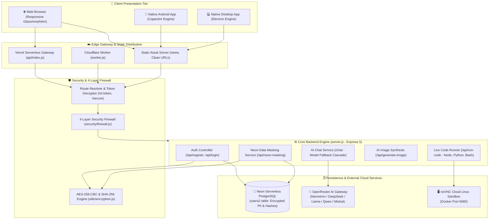

# 🧬 MindHelix AI — Next-Gen Multi-Platform AI Suite & Neural Workflows

> **Platform Version:** 2.5.0 (Enterprise Neural Edition)  
> **Target Platforms:** Web (Vercel / Node.js), Mobile (Capacitor Android), Desktop (Electron), Edge (Cloudflare Workers), Docker  
> **Status:** Fully Integrated, Production Active & Synchronized  
> **Interactive Workflows & Diagrams:** [WORKFLOW.md](WORKFLOW.md) | **Architecture Blueprint:** [ARCHITECTURE.md](ARCHITECTURE.md)

---

## ⚡ 1-Command Launch for Any Device

Run the entire MindHelix AI platform with **one single command** on any operating system:

| Device / Environment | One-Command Launch | What Happens |
| :--- | :--- | :--- |
| **Any System with Node.js** | `npm start` or `npx @dhyangandhi/mindhelix-ai` | Starts Express gateway and auto-opens default web browser |
| **Windows PC** | `start.bat` | 1-Click launcher: auto-verifies Node.js, installs dependencies, starts server |
| **macOS & Linux** | `bash start.sh` | Shell launcher with dependency verification & colorful CLI telemetry |
| **Docker / Cloud VPS** | `docker compose up -d` | Launches multi-runtime container (Node 20 + Python 3 + Bash) + noVNC desktop |
| **Desktop App (Electron)** | `npm run desktop` | Starts native standalone desktop window |

---

## 📐 1. System Overview

**MindHelix AI** is an intelligent, multi-platform AI automation, conversational reasoning, live code execution sandbox, and generative image synthesis suite. Engineered with a **glassmorphic dark-mode interface**, a high-performance **Express 5 backend gateway**, a **4-layer security firewall**, and an **interactive noVNC / Live Server sandbox**, the platform delivers a seamless, synchronized experience across **Web browsers**, **Android mobile devices**, **Windows desktop systems**, and **serverless edge networks**.

### Core Technology Stack Matrix

| Layer | Technology | Description |
| :--- | :--- | :--- |
| **Frontend UI** | HTML5, CSS3 Glassmorphism, Vanilla JS | Modern responsive dark mode interface, custom clean URL routing in `www/` |
| **Icons & Typography** | FontAwesome 6, Boxicons, Google Fonts | Outfit, JetBrains Mono & Plus Jakarta Sans typography |
| **Backend Gateway** | Node.js (v20+), Express.js (v5.2.1) | Non-blocking asynchronous REST API gateway & static file server in `server.js` |
| **Edge Serverless** | Cloudflare Workers (V8), Vercel Serverless | Low-latency edge distribution and API proxying via `worker.js` and `api/index.js` |
| **Security & Firewall** | 4-Layer WAF, AES-256-CBC, Bcrypt, SHA-256 | Perimeter shield, SQLi/XSS filters, brute-force lockout, prompt injection guard |
| **AI Conversational Hub** | OpenRouter Multi-Model Gateway | 5-tier fallback cascade: Nemotron $\rightarrow$ DeepSeek R1 $\rightarrow$ Llama 3.3 $\rightarrow$ Qwen 2.5 $\rightarrow$ Mistral |
| **Live Execution Sandbox** | Multi-runtime (Node.js, Python 3, Shell) | `/api/run-code` endpoint with millisecond execution timer & terminal stdout/stderr capture |
| **Remote Desktop (noVNC)** | HTML5 RFB WebSocket Client | Direct interactive access to containerized Linux GUI desktop |
| **AI Image Engine** | FLUX.1 Schnell, SDXL, Pollinations AI | Prompt styler, seed control, artistic presets, and high-resolution 8K rendering |
| **Database & ORM** | Neon Serverless PostgreSQL, Prisma ORM | Relational persistence, connection pooling (`pg.Pool`), SSL encryption |
| **Mobile Runtime** | `@capacitor/android` (v8.3.3) | Web-to-native Android Studio compilation wrapper (`capacitor.config.json`) |
| **Desktop Runtime** | Electron (v42.0.1) | Native Windows executable wrapper with Chromium runtime in `main.js` |

---

## 🏛️ 2. Master System Architecture Diagram



---

## 🎛️ 3. Navigation Controls & Navbar AI Bar

The top header bar provides instant access to model controls and a smooth minimize/expand drawer:

```
[≡] [MindHelix Logo] MindHelix AI  |  [🧠 MODEL]  [👥 SPECIALIST]  [🎛️ CREATIVITY]  [🗄️ Live Sandbox]  |  [Clear Chat] [Sign Out]
                                                     [ ▲ ]
```

- **🧠 MODEL:** Switch between free models on the fly (`Nemotron 3.5 Super VL`, `DeepSeek R1 Reasoning`, `Meta Llama 3.3 70B`, `Qwen 2.5 Coder 32B`, `Mistral Nemo 12B`).
- **👥 SPECIALIST:** Select expert system personas (`🚀 Full-Stack Architect`, `🛡️ Cyber Security & WAF`, `📊 Data Science & Python`, `🤖 General Intelligence`).
- **🎛️ CREATIVITY:** Adjust generation temperature (`0.2 Precise`, `0.7 Balanced`, `1.0 Creative`).
- **▲ Center Minimize Tab:** Slides the navigation bar up out of view (`translateY(-100%)`) with zero empty whitespace gaps, flipping the caret to `▼` to expand again on click.

---

## 🖥️ 4. Interactive Live Server & noVNC Sandbox

Directly run and preview code generated by the AI in chat:

- **Tab 1: Live Web Server:** Instant HTML/CSS/JavaScript editor with split-pane live preview, responsive device toggle (Desktop, Tablet, Mobile), and browser console bridge.
- **Tab 2: Backend Terminal Runner:** Executes Node.js, Python 3, and Bash/Shell scripts with millisecond execution timer and standard input (stdin) support.
- **Tab 3: noVNC Remote Desktop:** HTML5 RFB client connecting to a full graphical Linux desktop environment with clipboard synchronization.
- **Tab 4: Setup & Docker Guide:** 1-command Docker commands for local sandbox containers.

---

## 🧪 5. Testing & Verification

```bash
# Run security firewall audit and penetration test suite
npm run test:firewall

# Compile firewall rule matrix
npm run build:firewall

# Launch native desktop application (Electron)
npm run desktop

# Run with custom port
node bin/mindhelix.js --port 8080
```

---

## 📄 License & Credits

- **Author:** Dhyan Gandhi
- **License:** MIT License
- **Documentation:** For deep architectural specifications, see [ARCHITECTURE.md](ARCHITECTURE.md) and [WORKFLOW.md](WORKFLOW.md).
