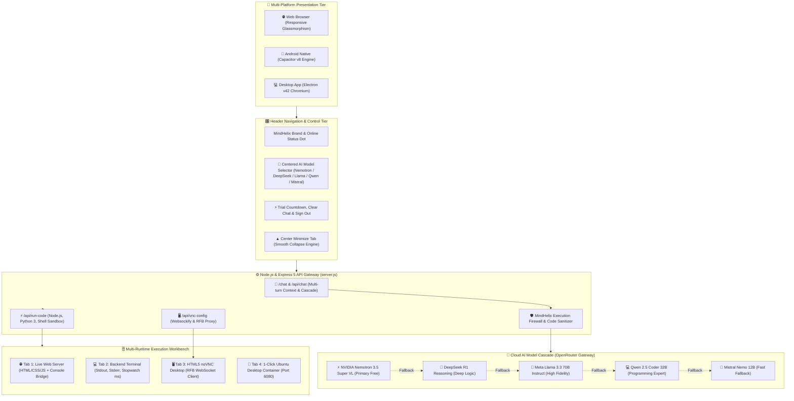
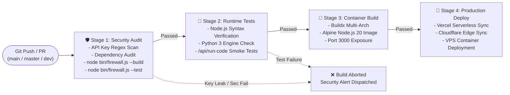
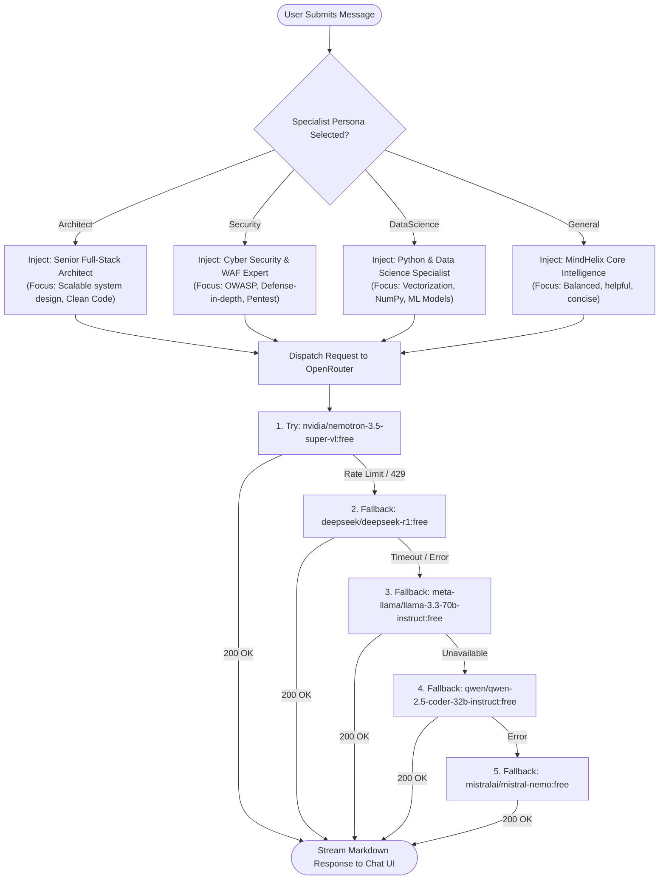
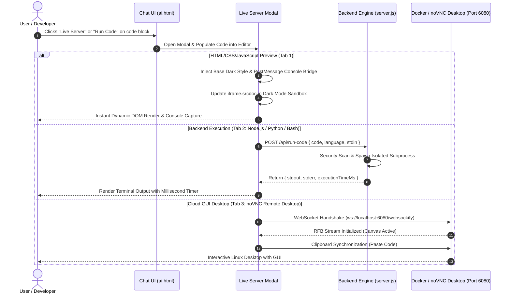
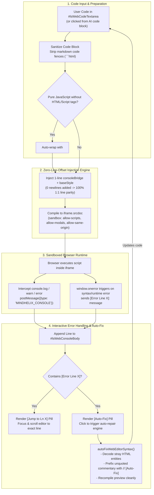
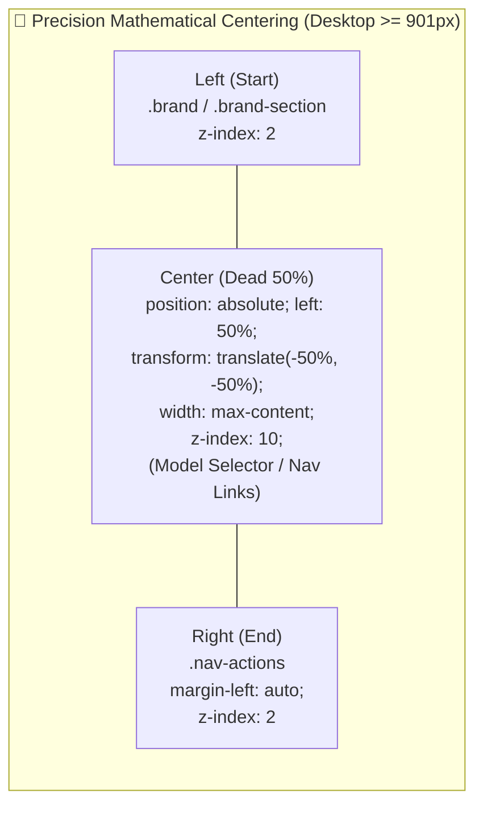
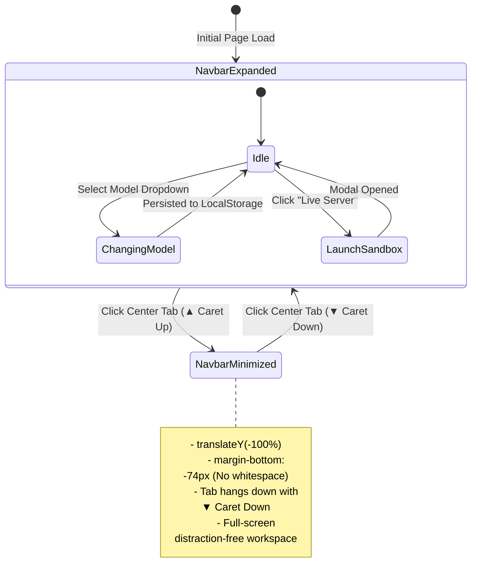
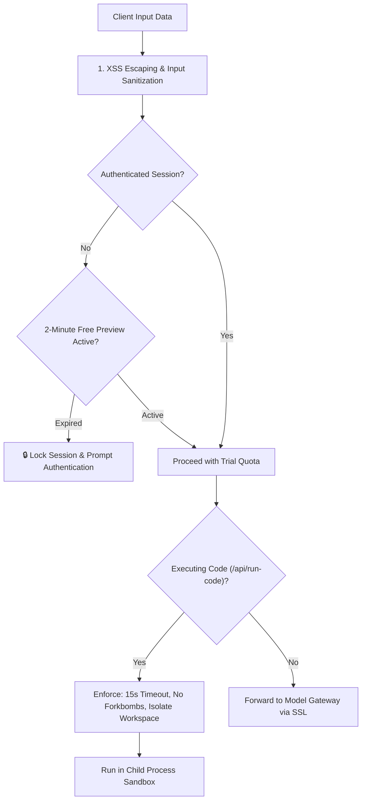

# 🚀 MindHelix AI — End-to-End System Workflows & Architecture Blueprint

> **Platform Version:** 2.5.0 (Enterprise Neural Edition)  
> **Repository:** [MindHelix AI](https://github.com/MindHelix/MindHelix-AI)  
> **Status:** Production Active & Synchronized  
> **Diagram Format:** GitHub Native Mermaid

---

## 📑 Table of Contents
1. [Master System Architecture](#-1-master-system-architecture)
2. [GitHub CI/CD Automation Pipeline](#-2-github-cicd-automation-pipeline)
3. [AI Model Fallback Cascade & Specialist Personas](#-3-ai-model-fallback-cascade--specialist-personas)
4. [Live Server & noVNC Sandbox Execution Workflow](#-4-live-server--novnc-sandbox-execution-workflow)
5. [Navbar UI Controls & Minimize State Machine](#-5-navbar-ui-controls--minimize-state-machine)
6. [Data Flow & Security Firewall](#-6-data-flow--security-firewall)

---

## 🏛️ 1. Master System Architecture

This architectural blueprint outlines how MindHelix AI routes client requests through edge middleware, AI model hubs, local code execution sandboxes, and remote HTML5 noVNC containers.

---

## 🔄 2. GitHub CI/CD Automation Pipeline

MindHelix AI utilizes an automated GitHub Actions pipeline (`.github/workflows/ci-cd.yml`) to ensure rigorous security audits, zero-leak API token checks, 4-layer firewall compilation, multi-runtime code execution testing, and automated Docker compilation.

---

## 🧠 3. AI Model Fallback Cascade & Specialist Personas

When a user submits a prompt, the system injects the selected specialist persona system instructions and dispatches the query through our resilient fallback cascade:

---

## ⚡ 4. Live Server & noVNC Sandbox Execution Workflow

MindHelix allows direct execution of generated code blocks without leaving the conversation interface:

### 4.1 Live Server Compiler & Auto-Fix Architecture

The Live Web Server integrates a single-line console bridge to guarantee **1:1 line number parity** and features an automated syntax resolution engine:

---

## 🎛️ 5. Navbar UI Controls & Centering Architecture

The navigation bar implements precision mathematical centering with responsive adaptive behaviors:

### Navbar Minimize & State Machine

---

## 🛡️ 6. Data Flow & Security Firewall

Every transaction passing through the MindHelix ecosystem is protected by our defense-in-depth security model:

---

## 🛠️ Quick Commands

| Task | Command |
| :--- | :--- |
| **Start Local App Server** | `node server.js` |
| **Run 1-Command Ubuntu Desktop noVNC** | `docker run -d -p 6080:80 -e RESOLUTION=1280x720 dorowu/ubuntu-desktop-lxde-vnc` |
| **Local Websockify Bridge** | `websockify 6080 localhost:5900` |
| **Trigger CI/CD Tests Locally** | `npm test` or `curl -X POST http://localhost:3000/api/run-code -H "Content-Type: application/json" -d '{"code":"console.log(1)","language":"javascript"}'` |

